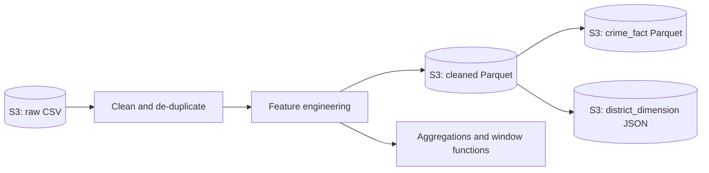

# Chicago Crime Analysis with PySpark on AWS EMR

PySpark analysis of the full **Chicago Crimes – 2001 to Present** dataset, run on an AWS EMR cluster
provided by my data-engineering mentorship programme. The notebook was executed on EMR and its
outputs are saved in [`chicago_crime_analysis.ipynb`](chicago_crime_analysis.ipynb), so the results
below can be checked without re-running it.

## What the notebook does

| Stage | What happens | Saved result |
| --- | --- | --- |
| Ingest | Read the raw CSV export from S3 with schema inference | **8,548,383 rows**, 22 columns |
| Profile | Classify columns by type; null percentage per column | e.g. Ward 7.19 % null, coordinates 1.13 % null |
| Clean | Drop rows without coordinates, parse `Date` to a timestamp, de-duplicate on `ID` and `Case Number`, cast `Arrest` / `Domestic` to boolean | 8,451,823 rows after the coordinate filter, **8,451,207** after de-duplication |
| Enrich | `time_of_day`, `is_violent_crime` (homicide, criminal sexual assault, battery), `district_name` | 1,574,913 rows flagged violent |
| Persist | Cleaned data written to S3 as Parquet and read back for later steps | — |
| Aggregate | Total crimes, arrests and arrest rate per district | district table |
| Window functions | Time since the previous crime in the same district (`lag`); top 3 districts per month (`dense_rank`) | ranked tables |
| Model | `crime_fact` written as Parquet, `district_dimension` written as JSON | written to S3 |
| Hotspots | Count crimes per cell of coordinates rounded to 3 decimals (roughly 100 m) | top 5 cells |
| Check | Stop with an error if any district has a negative arrest rate | check passed |

The notebook also contains written answers on Spark concepts: driver vs executors, data skew,
`repartition` vs `coalesce`, Parquet vs JSON, and Spot vs On-Demand instances.

## Environment and provenance

- AWS EMR, Sparkmagic (PySpark) notebook kernel; the session was configured with
  1 executor (1 core, 2 GB memory).
- Input and output paths point to an S3 bucket owned by the mentorship programme
  (`s3://<mentorship-bucket>/…`). It is not publicly readable, so the notebook cannot be re-run
  as it is.
- The saved outputs come from one Spark session; the execution counts show that a few cells were
  re-run during the session.
- I have not re-run the notebook since these outputs were saved.

## Reproducing it

You need your own copy of the dataset in S3 (or locally) and a Spark environment:

1. Download the dataset as CSV from the City of Chicago Data Portal (link below).
2. Upload it to an S3 location you control, or keep it locally.
3. Replace the S3 paths in the notebook with your own locations.
4. Run it on EMR with a Sparkmagic kernel, or remove the `%%configure` cell and run it in a local
   PySpark Jupyter kernel.

## Limitations and what I would improve

- Notebook only, no automated tests: next step is moving the logic into a `spark-submit` job with
  unit tests that runs on a small sample locally.
- Outputs are not partitioned; writing them partitioned by `Year` (discussed in the notebook) is
  not implemented yet.
- `days_since_crime` depends on the date the notebook runs, so it should not live in a fact table;
  the event date should be stored instead.
- `district_dimension` includes a `NULL` district; the data-quality checks are minimal and should
  cover row counts between stages and key uniqueness.
- The notebook has no join; the fact and dimension tables are written separately.

## Dataset

[Crimes – 2001 to Present](https://data.cityofchicago.org/Public-Safety/Crimes-2001-to-Present/ijzp-q8t2/about_data),
City of Chicago Data Portal.
