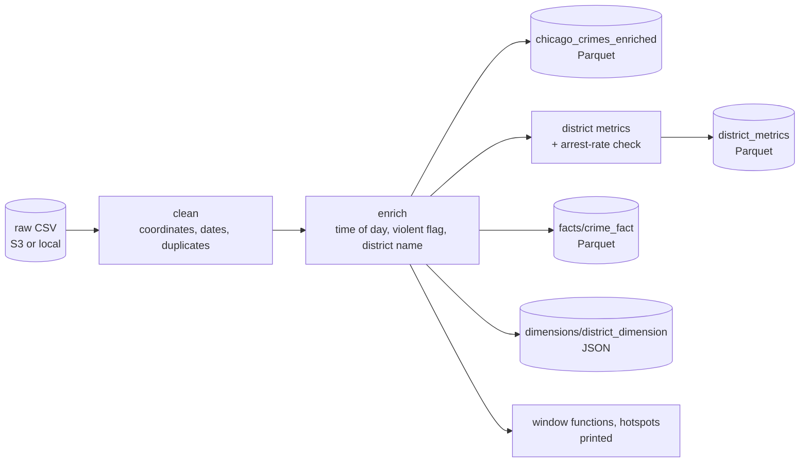

# Chicago Crime Analysis with PySpark on AWS EMR

[](https://github.com/ArturLy263/chicago-crime-spark-pipeline/actions/workflows/ci.yml)

PySpark analysis of the full **Chicago Crimes – 2001 to Present** dataset (8.5M rows), run once as a
notebook on an AWS EMR cluster provided by my data-engineering mentorship programme. The same logic
is also available as a Python package with a command-line job and unit tests that run locally on a
small synthetic sample, without AWS.

| What | Where | Verified by |
| --- | --- | --- |
| Original EMR run on the full dataset | [`chicago_crime_analysis.ipynb`](chicago_crime_analysis.ipynb) | outputs saved in the notebook (not re-run since) |
| Same transformations as functions | [`chicago_crime/transforms.py`](chicago_crime/transforms.py) | 18 pytest tests on synthetic data, GitHub Actions |
| Batch job (local path or `s3://`) | [`chicago_crime/pipeline.py`](chicago_crime/pipeline.py) | end-to-end test on [`examples/sample_crimes.csv`](examples/sample_crimes.csv) |

## Pipeline



| Stage | What happens | Result of the EMR run (from the notebook) |
| --- | --- | --- |
| Ingest | Read the raw CSV with a header and schema inference | **8,548,383 rows**, 22 columns |
| Profile | Classify columns by type; null percentage per column (notebook only) | e.g. Ward 7.19 % null, coordinates 1.13 % null |
| Clean | Drop rows without coordinates or with an unparseable `Date`, de-duplicate on `ID` and then `Case Number`, cast `Arrest` / `Domestic` to boolean, add `days_since_crime` | 8,451,823 rows after the coordinate filter, **8,451,207** after de-duplication |
| Enrich | `time_of_day` (Night 0–5 h, Morning 6–11, Afternoon 12–17, Evening 18–23), `is_violent_crime` (homicide, criminal sexual assault, battery), `district_name` (unknown codes → `Unknown`) | 1,574,913 rows flagged violent |
| Aggregate | Total crimes, arrests and arrest rate per district | district table |
| Quality check | Stop with an error if any district has a negative arrest rate | check passed |
| Window functions | Days since the previous crime in the same district (`lag`); top 3 districts per month (`dense_rank`) | ranked tables |
| Model | `crime_fact` as Parquet, `district_dimension` as JSON | written to S3 |
| Hotspots | Crimes per cell of coordinates rounded to 3 decimals (roughly 100 m) | top 5 cells |

The notebook also contains written answers on Spark concepts: driver vs executors, data skew,
`repartition` vs `coalesce`, Parquet vs JSON, and Spot vs On-Demand instances.

## Run it locally

Requirements: Python 3.12 or 3.14 and Java 17 or later. Commands run from the repository root.

```bash
python3 -m venv .venv
source .venv/bin/activate
pip install -r requirements-dev.txt        # requirements.txt alone is enough to run the job

python -m pytest tests -q

python -m chicago_crime.pipeline \
    --input examples/sample_crimes.csv --output output --as-of 2024-03-01
```

The job prints the row counts, the district metrics, the top districts per month and the hotspots,
and writes:

```text
output/
├── chicago_crimes_enriched/          # cleaned + enriched rows, Parquet
├── district_metrics/                 # Parquet
├── facts/crime_fact/                 # Parquet
└── dimensions/district_dimension/    # JSON
```

`--as-of` fixes the reference date for `days_since_crime`; without it, today's date is used, as in
the notebook.

**Sample data.** [`examples/sample_crimes.csv`](examples/sample_crimes.csv) has 13 hand-written,
synthetic rows with the 9 columns the pipeline uses (the real export has 22). It contains one row
without coordinates, one with an invalid date, an exact duplicate and a repeated case number, so
9 rows survive cleaning. It is not real crime data.

## Run it on the full dataset

1. Download the dataset as CSV from the City of Chicago Data Portal (link below).
2. Put it in an S3 location you control, or keep it locally.
3. Run the job with your own paths, e.g. on an EMR cluster:

   ```bash
   spark-submit --py-files chicago_crime.zip chicago_crime/pipeline.py \
       --input s3://<your-bucket>/chicago_crime/raw/ --output s3://<your-bucket>/chicago_crime/
   ```

   (`chicago_crime.zip` is the `chicago_crime/` folder zipped.) Or run the notebook with a Sparkmagic
   kernel after replacing `s3://<your-bucket>/…` with your locations.

The packaged job has only been run locally on the synthetic sample (with `python -m` and with
`spark-submit --master "local[1]"`); it has not been run on EMR or on
the full dataset. The figures above come from the notebook run.

## Tests and CI

`tests/test_pipeline.py` checks, on the sample file: which rows are dropped by cleaning and why,
column types, `days_since_crime` with a fixed date, `time_of_day` boundaries, the violent-crime
flag, district names including the `Unknown` fallback, district metrics and the arrest-rate check,
the `lag` and `dense_rank` window results, the hotspot cell, the fact and dimension tables, and that
the job writes all four outputs. GitHub Actions runs the tests on Python 3.12 and 3.14 with Java 17;
no AWS access or secrets are needed.

## Environment and provenance

- The notebook ran on AWS EMR with a Sparkmagic (PySpark) kernel; the session was configured with
  1 executor (1 core, 2 GB memory).
- The data was read from and written to an S3 bucket owned by the mentorship programme. It is not
  publicly readable, so after the run its name was replaced with `<your-bucket>` everywhere in the
  notebook, including the printed output paths; nothing else in the code or outputs was changed.
- The saved outputs come from one Spark session; the execution counts show that a few cells were
  re-run during the session. I have not re-run the notebook since.
- Two differences between the package and the notebook: dates are parsed with `try_to_timestamp`,
  so invalid dates become NULL and are dropped (plain `to_timestamp` raises an error under Spark 4's
  default ANSI mode), and the reference date for `days_since_crime` can be fixed with `--as-of`.

## Limitations and what I would improve

- Outputs are not partitioned; writing them partitioned by year (discussed in the notebook) is not
  implemented yet.
- `days_since_crime` depends on the run date, so it should not live in a fact table; the event date
  should be stored instead.
- `district_dimension` includes a `NULL` district, and `dropDuplicates` keeps an arbitrary row per
  key; data-quality checks are minimal and should cover row counts between stages and key uniqueness.
- The schema is inferred from the CSV; an explicit schema would be faster and safer on the full file.
- The fact and dimension tables are written separately; nothing joins them yet.

## Dataset

[Crimes – 2001 to Present](https://data.cityofchicago.org/Public-Safety/Crimes-2001-to-Present/ijzp-q8t2/about_data),
City of Chicago Data Portal.
